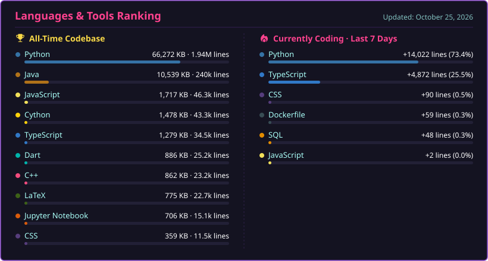
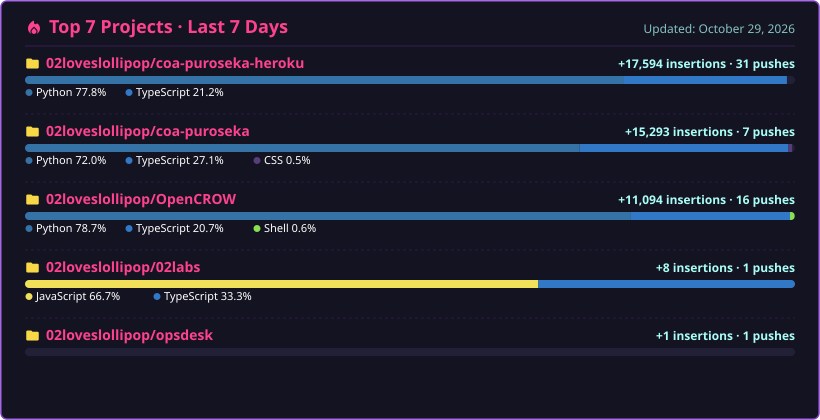
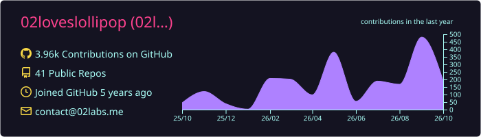

<!-- Intro  -->
<h3 align="center">
        <samp>&gt; Hey There!, I am
                <b><a target="_blank" href="https://02loveslollipop.uk">02loveslollipop</a></b>
        </samp>
</h3>

 # About me
 

 
  
 🎓 &emsp; Pursuing dual bachelor’s degrees in Systems & Computer Engineering and Data Science  
 ❤️ &emsp; Love writing code in Python, Go and C  
 📧 &emsp; Reach me anytime: contact@02labs.me  
 🌐 &emsp; My web page and blog: [02labs.me](https://02labs.me)  [blog.02labs.me](https://blog.02labs.me)  

 
 
 

## Use To Code

<!-- START_SECTION:use_to_code -->

  

<!--
Data for search engine crawlers and screen readers:
| Rank | All-Time Language | Codebase (KB) | Est. Lines | Codebase Share | Currently Coding | Recent Share |
| :--- | :--- | :--- | :--- | :--- | :--- | :--- |
| 1 | - | - | - | - | Python (+18,734 lines) | 75.9% |
| 2 | - | - | - | - | TypeScript (+5,734 lines) | 23.2% |
| 3 | - | - | - | - | CSS (+90 lines) | 0.4% |
| 4 | - | - | - | - | Dockerfile (+60 lines) | 0.2% |
| 5 | - | - | - | - | SQL (+48 lines) | 0.2% |
| 6 | - | - | - | - | Shell (+25 lines) | 0.1% |
| 7 | - | - | - | - | JavaScript (+4 lines) | 0.0% |
-->
<!-- END_SECTION:use_to_code -->

 

<!-- START_SECTION:weekly_repos -->

  

<!--
Public projects pushed in the rolling last 7 days (all branches).
Language shares reflect code additions in those pushes.
Top Contributed Projects Data:
| Rank | Repository | Insertions | Commits | Pushes | Languages Pushed |
| :--- | :--- | :--- | :--- | :--- | :--- |
| 1 | 02loveslollipop/coa-puroseka-heroku | +17,594 lines | 33 commits | 31 pushes | Python (77.8%), TypeScript (21.2%) |
| 2 | 02loveslollipop/coa-puroseka | +15,293 lines | 8 commits | 7 pushes | Python (72.0%), TypeScript (27.1%), CSS (0.5%) |
| 3 | 02loveslollipop/OpenCROW | +11,126 lines | 26 commits | 18 pushes | Python (78.8%), TypeScript (20.5%), Shell (0.6%) |
| 4 | 02loveslollipop/02labs | +8 lines | 1 commits | 1 pushes | JavaScript (66.7%), TypeScript (33.3%) |
| 5 | 02loveslollipop/opsdesk | +1 lines | 1 commits | 1 pushes |  |
-->
<!-- END_SECTION:weekly_repos -->

 

### Frameworks, Tools & Platforms

               

 

 

 

  

  

 
  
  

